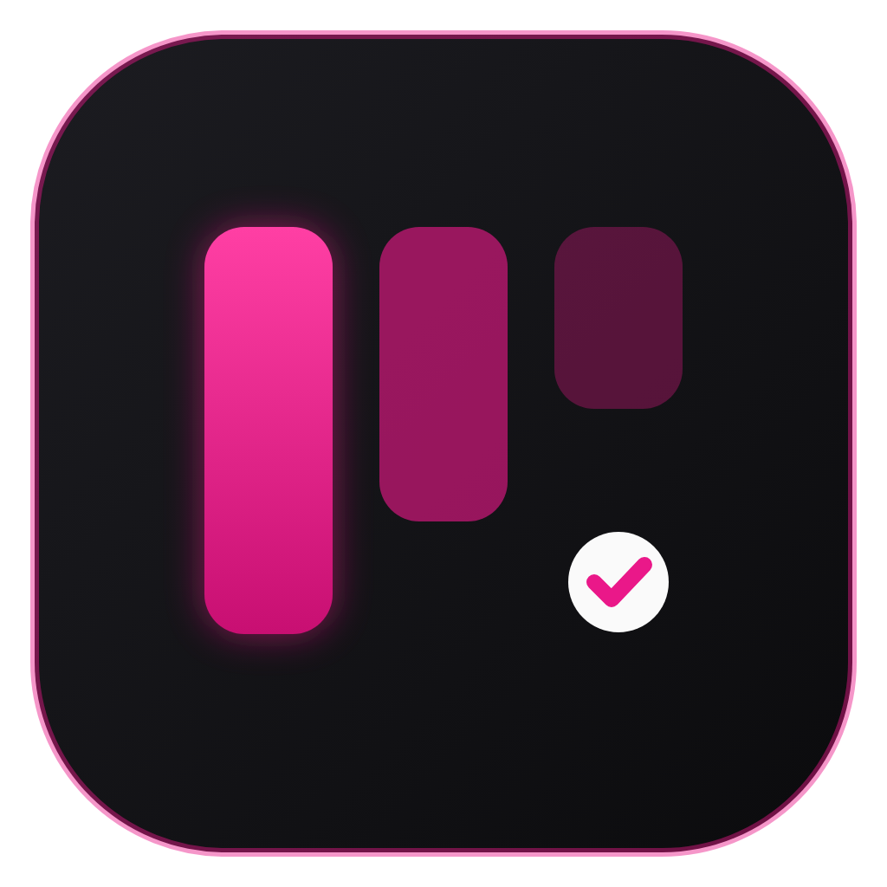

<div align="center">



# record-mind

**Anota el detalle. Claude lo resuelve.**

Tablero de micro-pendientes para trabajar con [Claude Code](https://claude.com/claude-code):
capturas lo que hay que corregir con una nota y una captura de pantalla, Claude lo resuelve
consultando la memoria de [Engram](https://engram.gentlemanprogramming.com/) y te lo deja para revisar.

[](LICENSE)


</div>

---

## Por qué existe

Cuando trabajas con Claude Code van saliendo detalles que se le pasaron: un texto muy pequeño,
una imagen que no carga, un estado hover que falta. Anotarlos en un chat aparte, con capturas
sueltas, hace que se pierdan, y Claude no los puede leer.

record-mind convierte cada detalle en una tarjeta con su nota y su captura. Claude las toma
desde el tablero, las resuelve con el contexto de tu memoria de Engram, guarda lo que aprende
y las deja **para que tú las revises**. Nunca se marcan como hechas sin tu aprobación.

```
 Capturado  ──▶  Claude trabajando  ──▶  Para revisar  ──▶  Hecho
   (tú)             (solo Claude)          (tú decides)
```

## Funciones

- **Captura rápida desde cualquier app** con <kbd>Ctrl</kbd>+<kbd>Shift</kbd>+<kbd>Espacio</kbd>:
  escribes la nota, añades una captura y <kbd>Enter</kbd>. El proyecto sale por defecto de la
  conversación de Claude Code con actividad más reciente; si tienes varias abiertas, todas aparecen
  marcadas en el selector.
- **Recorte de pantalla integrado**: «Recortar pantalla» (en la captura o en la bandeja) congela
  el monitor donde está el ratón; arrastras sobre lo que quieres y queda añadido al pendiente.
  También puedes pegar con <kbd>Ctrl</kbd>+<kbd>V</kbd> o arrastrar una imagen.
- **Anota la captura antes de guardarla**: clic en la miniatura y marca lo que importa con
  flechas, recuadros, lápiz o números. Se puede deshacer y volver a editar, y Claude recibe la
  imagen ya anotada.
- **Tus proyectos de Claude Code, siempre a mano**: el tablero y la captura muestran todas las
  carpetas donde has usado Claude Code, aunque no tengan tareas ni una conversación abierta.
- **Tablero en vivo** con arrastrar y soltar. Cualquier cambio (Claude por MCP, la CLI o la app)
  se ve al instante, con avisos como «Claude tomó #12» o «#12 lista para revisar».
- **Tú eliges qué trabaja Claude**: marcas tarjetas con **«+ Para Claude»** y `/pendientes`
  trabaja solo esas. Sin marcas, Claude te pregunta cuáles.
- **Estado real, no decorativo**: solo Claude pasa tareas a «Claude trabajando» y, mientras la
  tiene, la tarjeta queda bloqueada y muestra quién la trabaja, desde cuándo y su último avance.
- **Revisión con contexto**: en el detalle ves lo que hizo Claude, los archivos que tocó, las
  memorias de Engram que consultó o creó, y puedes **Aprobar**, **Devolver con nota** o
  **responderle** si dejó una pregunta.
- **Memoria que se alimenta sola**: cuando Claude descubre algo no obvio al resolver una tarea,
  lo guarda en Engram; la próxima vez lo encuentra antes de tocar código.
- **Errores que se repiten → reglas para `CLAUDE.md`**: al terminar `/pendientes`, Claude revisa
  las tareas que devolviste y lo que se repite entre ellas. Si ve un error que vuelve, te propone
  una regla en **«Reglas sugeridas»**; la editas si quieres y con «Añadir a CLAUDE.md» queda
  escrita en el `CLAUDE.md` del proyecto. Claude nunca lo edita por su cuenta.
- **Dictado por voz**: el botón **Dictar** de la captura abre el dictado de Windows (`Win+H`)
  sobre la nota.
- **Ligera**: núcleo en Rust, instalador de ~4 MB, vive en la bandeja del sistema y puede
  iniciarse con Windows.

## Cómo funciona

```
   Tú                          record-mind                           Claude Code
 ──────                 ─────────────────────────              ────────────────────
 Ctrl+Shift+Espacio ──▶  ventana de captura                     /pendientes
                              │                                      │
                              ▼                                      ▼
                        ~/.record-mind/  ◀──── MCP (stdio) ───  list · get · claim
                        record-mind.db                          complete · comment
                              │                                      │
 tablero en vivo  ◀──── vigila cambios                               │ mem_search / mem_save
                              │                                      ▼
                              └──── lee (solo lectura) ────▶   ~/.engram/engram.db
```

1. **Capturas** una tarea. Queda en «Capturado», en el proyecto de tu conversación más reciente.
2. **Eliges** cuáles trabajar (opcional) con «+ Para Claude».
3. En tu sesión escribes **`/pendientes`**. Claude toma cada tarea, consulta Engram, la arregla,
   la verifica y la entrega con un resumen honesto.
4. **Revisas** en el tablero: apruebas o devuelves con una nota, que Claude leerá primero la
   próxima vez.

Más detalle en [docs/arquitectura.md](docs/arquitectura.md).

## Instalación

> Requisitos: Windows 10/11, [Claude Code](https://claude.com/claude-code) y, para las funciones
> de memoria, [Engram](https://engram.gentlemanprogramming.com/) (opcional).

1. **App**: descarga `record-mind_<versión>_x64-setup.exe` desde
   [Releases](../../releases) y ábrelo con **doble clic** desde el Explorador.
2. **CLI / servidor MCP**: descarga `record-mind.exe` del mismo release (o compílalo, ver abajo),
   déjalo en una carpeta de tu `PATH` y regístralo en Claude Code:

   ```bash
   claude mcp add -s user record-mind -- "C:/ruta/a/record-mind.exe" mcp
   ```

3. **Skill `/pendientes`**: copia [`claude/skills/pendientes`](claude/skills/pendientes) a
   `~/.claude/skills/pendientes`.

> [!IMPORTANT]
> No instales ni lances la app desde una terminal de **Claude Desktop**. Es una app empaquetada
> (MSIX) y todo lo que se lanza desde ahí queda dentro de su carpeta virtual: el acceso directo no
> funcionaría fuera de Claude. Usa el Explorador. Más en [docs/arquitectura.md](docs/arquitectura.md#datos-y-la-virtualización-de-claude-desktop).

## Uso

### `/pendientes` en Claude Code

| Escribes | Claude trabaja |
|---|---|
| `/pendientes` | Las tarjetas que marcaste **«Para Claude»** en el tablero |
| `/pendientes` (sin marcas) | Te muestra las tareas y eliges una, varias o todas |
| `/pendientes 4 7` | Solo la #4 y la #7 |
| `/pendientes todas` | Todas las capturadas del proyecto |

### Atajos

Los dos atajos globales se cambian en **Ajustes** (abajo a la izquierda en el tablero): haz clic
en el atajo y pulsa la nueva combinación. Si Windows u otra app ya la usa, te avisa y se queda el
anterior. Se guardan en `~/.record-mind/settings.json`.

| Atajo | Dónde | Acción |
|---|---|---|
| <kbd>Ctrl</kbd>+<kbd>Shift</kbd>+<kbd>Espacio</kbd> | Cualquier app | Abre la captura rápida (se cambia en **Ajustes**) |
| Sin atajo por defecto | Cualquier app | Recorta la pantalla directamente (se asigna en **Ajustes**) |
| <kbd>Enter</kbd> / <kbd>Shift</kbd>+<kbd>Enter</kbd> | Captura | Guardar / salto de línea |
| <kbd>Esc</kbd> | Captura, detalle | Cerrar |
| <kbd>Ctrl</kbd>+<kbd>K</kbd> | Tablero | Buscar |

### CLI

```bash
record-mind add "No carga el logo del encabezado" -i captura.png   # proyecto = conversación más reciente
record-mind add "Subir el título" -p mi-proyecto --priority 1
record-mind list                    # capturado, trabajando y para revisar (--all incluye hechas)
record-mind show 3                  # nota, capturas, resolución, memorias e historial
record-mind queue 3 5               # en cola para /pendientes (--off para quitar)
record-mind approve 3               # Para revisar → Hecho
record-mind reopen 3 "falta también el subtítulo"
record-mind release 3               # saca una tarea de «Claude trabajando»
record-mind where                   # rutas y sesiones activas detectadas
```

## Desarrollo

```bash
cargo test                       # núcleo
cargo build --release            # CLI: target/release/record-mind.exe
cd app && npm install
npm run tauri dev                # app en modo desarrollo
npm run tauri build              # instalador: target/release/bundle/nsis/
```

Guía completa (requisitos, depuración de la interfaz, publicación) en
[docs/desarrollo.md](docs/desarrollo.md).

## Documentación

- [Arquitectura](docs/arquitectura.md): componentes, modelo de datos, reglas del tablero,
  integración con Engram.
- [Servidor MCP](docs/mcp.md): referencia de las herramientas para Claude Code.
- [Desarrollo](docs/desarrollo.md): compilar, probar, depurar y publicar.

## Estructura

```
crates/core              modelos, base de tareas (SQLite) y lector de Engram
crates/mcp               servidor MCP (rmcp): stdio y Streamable HTTP
crates/cli               binario `record-mind` (CLI + MCP por stdio)
app/src-tauri            app de escritorio (Rust, Tauri 2)
app/src                  interfaz (React 19, TypeScript, Tailwind 4, dnd-kit, Motion)
claude/skills/pendientes skill /pendientes para Claude Code
site/                    página de presentación
docs/                    documentación
```

## Hoja de ruta

- [x] **Fase 0**: núcleo, servidor MCP, CLI y skill.
- [x] **Fase 1**: app de escritorio con captura rápida, tablero en vivo, cola para `/pendientes`,
  bloqueo mientras Claude trabaja, inicio con Windows.
- [x] **Fase 2**: anotar capturas (flechas, recuadros, lápiz, números), recorte de pantalla
  nativo, atajos configurables.
- [x] **Fase 3**: errores repetidos → reglas sugeridas para `CLAUDE.md` (aprobadas desde el
  tablero) y dictado por voz con el de Windows. El grafo de tareas, memorias y sesiones se deja a
  [Engram View](https://github.com/ArangoMzl/engram-view), que ya lo tiene.
- [ ] **Más adelante**: «Resolver con Claude» desde el tablero.

## Licencia

[MIT](LICENSE) © 2026 ArangoMzl. No es un proyecto oficial de Anthropic ni de Engram.
